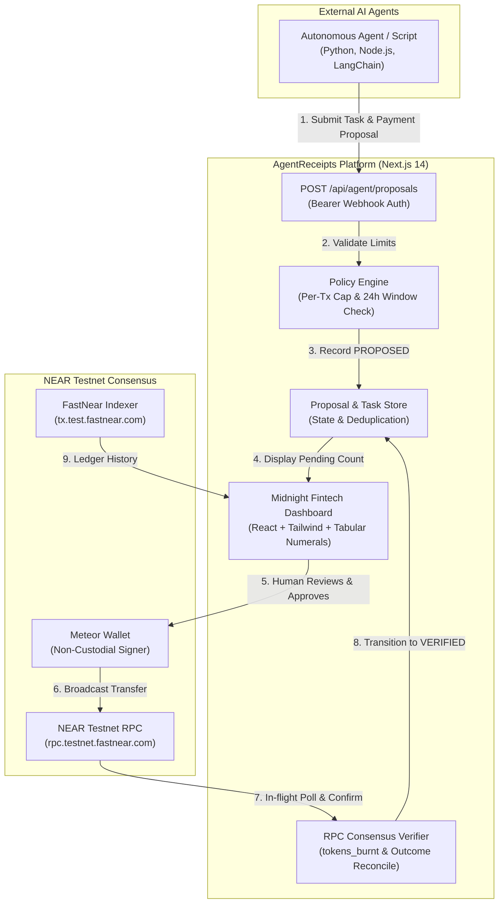

# 🧾 AgentReceipts — Financial Control & Audit for AI Agents

> **AgentReceipts is an evidence-first financial control and audit platform for AI agents. It connects on-chain payments to agent tasks, tracks spending against policies, and produces verifiable financial reports across supported blockchain networks.**

[](tests/)
[](https://testnet.nearblocks.io)
[](https://wallet.meteorwallet.app)
[](https://nextjs.org)
[](src/app/globals.css)

---

## 🎯 The Problem

As autonomous AI agents receive budgets to pay for API micro-services, purchase compute, execute token transfers, and settle data queries, their human operators face three critical vulnerabilities:

1. **The Hash Black Box**: Blockchain explorers only display raw cryptographic hashes, execution outcomes, and scientific yoctoNEAR notation (`10^24`). They provide zero visibility into *which* agent, mission, or prompt authorized an outlay.
2. **Runaway Autonomous Spend**: Without deterministic spending policies, a rogue loop or prompt injection can rapidly drain an agent's balance before an operator notices.
3. **Audit Unreliability**: Traditional crypto dashboards lack verifiable links between runtime task context and immutable on-chain settlements, making financial and regulatory audit impossible.

---

## 💡 The Solution

AgentReceipts implements **Option A (Human-in-the-Loop)** non-custodial authorization and verifiable attribution:

- **Proposal Before Transfer**: External AI agents cannot directly broadcast transactions. Instead, they submit structured payment proposals to AgentReceipts.
- **Two-Tier Spending Policy**: Every proposal is evaluated by an automated policy engine enforcing per-transaction caps and rolling 24-hour cumulative limits.
- **Dynamic Payer Authorization**: Any supported NEAR Testnet account connected via Meteor Wallet can act as the human approver and transaction signer.
- **Cryptographic On-Chain Verification**: After signing in Meteor Wallet, AgentReceipts queries NEAR Testnet RPC to verify block inclusion, gas burnt, exact burnt fees, and recipient reconciliation before generating a verified receipt.
- **Verifiable Receipts & Audit Trails**: Every transaction produces an evidence-backed receipt and printable audit statement exportable to RFC 4180 CSV.

---

## 🏗️ Architecture



---

## ⚡ Key Implemented Features

### 1. Human-in-the-Loop Wallet Authorization
- Seamless integration with **Meteor Wallet** via `@near-wallet-selector`.
- Operates on **NEAR Testnet** exclusively.
- The human operator inspects recipient, task prompt, amount, and policy limits before signing.

### 2. Dynamic Connected-Wallet Payer Authorization
- External agents do not need to hardcode a single static funding account.
- Any active NEAR Testnet wallet connected to AgentReceipts can review, approve, and broadcast the transaction.
- Receipts and audit statements accurately record the actual payer account that signed the on-chain transfer.

### 3. Automated Two-Tier Policy Enforcement
- **Per-Transaction Cap**: Default `0.05 NEAR` maximum per task. Any proposal exceeding this limit is rejected before wallet activation.
- **Rolling 24-Hour Cumulative Limit**: Default `0.20 NEAR` maximum spending window. Tracks all confirmed outlays in the last 24 hours.
- Re-evaluated at proposal time, pre-approval time, and settlement verification time.

### 4. Automatic Polling & Settlement Verification
- After wallet signature, the dashboard automatically polls NEAR Testnet RPC with exponential backoff.
- Transient indexing delays are classified as `PENDING_FINALITY` without premature failure.
- Status smoothly transitions from `SUBMITTED` to `VERIFIED` in real-time without requiring manual refresh.

### 5. Exact YoctoNEAR Network Fee Accounting
- Network fees are calculated from exact on-chain `tokens_burnt` (converted with exact integer $10^{24}$ division).
- Protocol fees are kept strictly isolated and never double-counted into transfer totals.
- Displays exact fee precision down to 12 decimal places (`0.000044636512 NEAR`).

### 6. Midnight Fintech v2.0 Visual Identity
- Deep midnight navy surface (`#080D19`) with restrained radial ambient lighting (blue, cyan, indigo, violet).
- Smooth cubic Bézier spline curve (`createSmoothPath`) for daily spending trends.
- Tabular numeric alignment (`tabular-nums`) and responsive mobile navigation drawer.

---

## 🛠️ Tech Stack

- **Framework**: Next.js 14 (App Router), React 18, TypeScript 5
- **Styling**: Tailwind CSS, PostCSS, Lucide Icons
- **Blockchain Connectivity**: 
  - `@near-wallet-selector/core`
  - `@near-wallet-selector/meteor-wallet`
  - `@near-wallet-selector/modal-ui`
  - `near-api-js`
- **Indexing & RPC**: FastNear Testnet Indexer API (`tx.test.fastnear.com`) and NEAR Testnet RPC (`rpc.testnet.fastnear.com`)
- **Testing**: Node.js Native Test Runner (`node --test`), 123 automated test assertions across 18 test suites

---

## 📋 Environment Configuration

Copy `.env.example` to `.env.local`:

```bash
cp .env.example .env.local
```

### Environment Variables Reference

| Variable | Required | Description |
| :--- | :---: | :--- |
| `AUTH_SECRET` | **Yes** | 32+ character random string for session signing. |
| `AGENT_WEBHOOK_SECRET` | **Yes** | 32+ character secret required to authenticate agent proposals. |
| `NEAR_RPC_URL` | Optional | Defaults to `https://rpc.testnet.fastnear.com`. Only Testnet hosts accepted. |
| `FASTNEAR_API_KEY` | Optional | FastNear API key for elevated rate limits. |
| `NEXT_PUBLIC_DEFAULT_NEAR_ACCOUNT` | Optional | Default monitored Testnet account (e.g. `agent-operator.testnet`). |

> 🔒 **Security Notice**: `.env.local` is strictly ignored by `.gitignore` and must never be committed.

---

## 🚀 Quickstart & Local Development

### Prerequisites
- Node.js 18.17+ or Node.js 20+
- A NEAR Testnet wallet (e.g. via [Meteor Wallet](https://wallet.meteorwallet.app))

### 1. Install Dependencies
```bash
npm install
```

### 2. Configure Environment
```bash
# Generate random 32-character secrets
export AUTH_SECRET=$(openssl rand -hex 16)
export AGENT_WEBHOOK_SECRET=$(openssl rand -hex 16)

# Create local configuration
cat <<EOF > .env.local
AUTH_SECRET=${AUTH_SECRET}
AGENT_WEBHOOK_SECRET=${AGENT_WEBHOOK_SECRET}
NEAR_RPC_URL=https://rpc.testnet.fastnear.com
NEXT_PUBLIC_DEFAULT_NEAR_ACCOUNT=agent-operator.testnet
EOF
```

### 3. Run Development Server
```bash
npm run dev
```
Open [http://localhost:3000](http://localhost:3000) in your browser.

---

## 🧪 Running the Test Suite

AgentReceipts includes **123 automated tests** covering status polling, fee calculation, dynamic payer authorization, policy limits, and security constraints:

```bash
npm test
```

To run type checking:
```bash
npx tsc --noEmit
```

---

## 🤖 External AI Agent Integration Guide

External AI agents (written in Python, Node.js, Go, or agent frameworks like LangChain/AutoGPT) communicate with AgentReceipts via REST API or the included client script.

### 1. Submit Payment Proposal via API

```bash
curl -X POST http://localhost:3000/api/agent/proposals \
  -H "Content-Type: application/json" \
  -H "Authorization: Bearer <AGENT_WEBHOOK_SECRET>" \
  -d '{
    "taskType": "ORACLE_PRICE_FETCH",
    "payerAccount": "agent-operator.testnet",
    "recipientAccount": "oracle.testnet",
    "amountNear": 0.02,
    "prompt": "Retrieve latest NEAR/USD feed and settle oracle micro-fee",
    "agentId": "external-oracle-agent.testnet",
    "agentName": "External Oracle Data Agent",
    "network": "testnet"
  }'
```

**Response (HTTP 201 Created):**
```json
{
  "success": true,
  "message": "Task queued and payment proposal created for human authorization",
  "proposal": {
    "proposalId": "PROP-XXXXXXXX-XXX",
    "status": "PROPOSED",
    "amountNear": 0.02,
    "recipientAccount": "oracle.testnet"
  }
}
```

### 2. Check Proposal Status

```bash
curl -H "Authorization: Bearer <AGENT_WEBHOOK_SECRET>" \
  http://localhost:3000/api/agent/proposals/PROP-XXXXXXXX-XXX
```

### 3. Agent CLI Client Script
The repository includes an agent simulator script:

```bash
# Propose a valid 0.02 NEAR payment
node scripts/external-agent-client.mjs --amount 0.02 --prompt "Data query fee"

# Propose an outlay exceeding the 0.05 NEAR per-tx cap (automatically rejected)
node scripts/external-agent-client.mjs --amount 0.06 --prompt "Excessive compute fee"
```

---

## 🔍 Judge Evaluation Walkthrough (<3 Minutes)

Follow these steps to evaluate the complete end-to-end workflow:

### Step 1: Connect Meteor Wallet
1. Open [http://localhost:3000](http://localhost:3000).
2. Click **"Connect Wallet"** in the top header or sidebar.
3. Select **Meteor Wallet** in the NEAR Wallet Selector modal and approve the connection on NEAR Testnet.
4. **Expected Result**: Your connected Testnet address appears in the header and sidebar under **Signer Wallet**.

### Step 2: Agent Submits a Proposal
1. In your terminal, run the agent client script:
   ```bash
   node scripts/external-agent-client.mjs --amount 0.02 --prompt "Hackathon judge evaluation query"
   ```
2. **Expected Result**: The terminal prints a proposal ID (e.g. `PROP-...`), status `PROPOSED`, and begins polling.

### Step 3: Human Reviews & Approves Payment
1. Return to the dashboard. Observe the amber notification banner: **"Pending Agent Payment Proposals (1 Awaiting)"**.
2. Click **"Review & Approve"** (or click **"Proposals"** in the header).
3. The Payment Proposals modal opens, displaying:
   - Requesting agent name and ID
   - Task prompt snippet
   - Recipient address and amount (`0.02 NEAR`)
   - Pre-approval policy check confirmation: `Within 0.05 cap`
4. Click **"Approve via Meteor Wallet"**.
5. Meteor Wallet prompts you to sign the `0.02 NEAR` transfer. Click **Confirm**.

### Step 4: Automatic Polling & Settlement
1. After signing, watch the modal status:
   - Changes to **"Confirming on NEAR"** (showing the on-chain transaction hash).
   - Automatically polls Testnet RPC.
   - Transitions to **"Payment Verified & Settled"** with a green checkmark without clicking refresh.
2. The agent terminal polling script exits with `Status: VERIFIED`.

### Step 5: Test Spending-Limit Protection
1. In your terminal, attempt to submit a proposal exceeding the policy cap:
   ```bash
   node scripts/external-agent-client.mjs --amount 0.06 --prompt "Attempted breach"
   ```
2. **Expected Result**: The proposal is immediately rejected by the policy engine (`HTTP 422`). Meteor Wallet is never opened, and no funds can be transferred.

### Step 6: Inspect Receipt & Audit Statement
1. In the **Payment Activity** table, click **"View receipt"** on the settled transaction.
2. Inspect the verified task ID, prompt snippet, exact burnt gas, and explorer link.
3. Click **"Audit Statement"** in the header to view the reconciliation statement or click **"Export CSV"** to download the record.

---

## 📄 License

MIT License. Designed and built for the NEAR Hackathon 2026.
